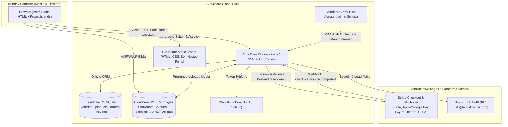

# Auto Kremer Website Relaunch — Ist-Analyse, Architektur & Design-Konzept

**Stand:** November 2026  
**Projekt:** Komplett-Rebuild & Redesign von `https://www.auto-kremer.com`  
**Zielplattform:** Cloudflare (Cloudflare Workers mit Static Assets, D1, R2, Cloudflare Images, Turnstile, Web Analytics)

---

## 1. Analyse & Content-Audit (Ist-Zustand)

### 1.1 Plattform & Unternehmensprofil
Die bestehende Webseite basiert auf dem **Wix Website Builder (Wix Thunderbolt + Wix Stores + Wix Multilingual)** und wird hinter einem Cloudflare-Proxy ausgeliefert (`X-Wix-Request-Id`).

Hinter **Auto Kremer GbR** (Buchenweg 3, 53227 Bonn) steht eine außergewöhnliche, authentische Markenhistorie, die auf der aktuellen Webseite jedoch über mehrere versteckte und doppelte Unterseiten verstreut ist:
- **1967:** Gründung durch Dieter und Marlene Kremer – erste offizielle Werksniederlassung für Alfa Romeo Deutschland.
- **1974:** Erster direkter Kontakt zu *Automobili Lamborghini SpA* in Sant’Agata Bolognese.
- **1981:** Offizieller Lamborghini-Vertragshändler.
- **1995:** Auszeichnung als **„Automobili Lamborghini European Dealer of the Year“**.
- **Heute:** Familienbetrieb unter Leitung von **Jason Kremer** & **Marvin Kremer** (Gesellschafter / CEO), unterstützt von **Barbara Kremer** (Serviceberaterin) und **Gena Kamin** (Mechaniker). Kernkompetenzen: Wartung, Reparatur & Vollrestauration klassischer und moderner Lamborghinis sowie ausgewählter italienischer/deutscher Sportwagen, Fahrzeughandel/-kommission und Verkauf seltener *Ricambi Originali* Lamborghini-Originalteile.

---

### 1.2 Seiten-für-Seite Content-Inventar (alle 10 Ziel-URLs + Sitemap-Funde)

| URL | Ist-Titel (`<title>`) | Gefundene Inhalte | Kritische Mängel auf der Seite |
| :--- | :--- | :--- | :--- |
| `/` (Startseite) | `Start \| Auto Kremer \| Premium Lamborghini Service in Bonn` | Hero-Hintergrundvideo, Buttons `INVENTAR ANSEHEN` (`/verkaufsraum`) & `VERKAUFTE AUTOS` (`/sold-cars`), Bildergalerie, 4 Leistungsblöcke (`SUPERCAR INSPECTION`, `REPAIR`, `MAINTENANCE`, `RESTAURATION`), CTA `CONTACT US` (`/contact-us`). | Sprachmix (DE-Meta, EN-Texte, DE-Buttons, Schreibfehler `RESTAURATION` im Englischen); **4× `<h1>`-Tags** auf einer Seite; 958 KB allein für das HTML-Dokument. |
| `/about-us` | `Lamborghini Auto Kremer \| Supercar Service Bonn - Europa` | Englischer Missionstext (`SINCE 1967`), Team-Sektion (`OUR TEAM`) mit Porträts von Jason Kremer, Marvin Kremer, Barbara Kremer, Gena Kamin; private E-Mails `J.autokremer@gmail.com` & `M.autokremer@gmail.com`. | Komplett auf Englisch trotz `lang="de"`; die wertvolle Meilenstein-Chronik (1967/1974/1981/1995) fehlt hier komplett und liegt stattdessen versteckt auf `/kontakt` und `/news`. |
| `/consign-your-car` | `Lamborghini Auto Kremer \| Supercar Service Bonn - Europa` | Überschrift `CONSIGN YOUR CAR`, darunter **lediglich Adresse, Telefonnummern und Öffnungszeiten** (Mo–Do 9:00–18:00, Fr 9:00–16:45). | **Kein Formular vorhanden** (obwohl Ziff. 7 der Datenschutzerklärung explizit ein Ankaufsformular beschreibt!). **Kritischer Bug:** Klick auf die E-Mail-Links öffnet `mailto:info@mysite.com` (Wix-Platzhalter!). Drei kaputte Platzhalter-Grafiken (`alt="Test Button"`). |
| `/verkaufsraum` | `Lamborghini Auto Kremer \| Supercar Service Bonn - Europa` | Überschrift `CARS IN STOCK` + **5 aktuelle Fahrzeuge** mit Mini-Bilderslidern und Kurzbeschreibung, jeweils Buttons `KONTAKT` (`/contact-us`) und `AUF MOBILE.DE ANSEHEN`. | **Keine eigenen Fahrzeug-Detailseiten**, keine Preisangaben, keine strukturierten technischen Daten (EZ, KM, Leistung, Getriebe), keine Filter. Nicht direkt im Hauptmenü verlinkt. Mobile.de-Links stammen aus WhatsApp-Shares (`utm_source=net.whatsapp...`), 2 davon mitten im Parameter abgeschnitten; rohe UUIDs als Bild-Alt-Texte. |
| `/sold-cars` | `Lamborghini Auto Kremer \| Supercar Service Bonn - Europa` | **3 verkaufte Referenzfahrzeuge** als reine Bilderslider mit Modellnamen darunter. | **0 Überschriften (`<h1>`/`<h2>` fehlen komplett)**, keinerlei Fahrzeugdaten, Baujahre oder Beschreibungen; Kamera-Dateinamen (`IMG_9716`, `IMG_9717`) sichtbar als Alt-Texte; im Header nicht direkt erreichbar. |
| `/category/all-products` | `All Products \| Auto Kremer` | **116 Lamborghini-Ersatzteile** (*Ricambi Originali* & Zubehör) mit OEM-Teilenummer im Produktnamen, Preisspanne **0,65 € bis 1.854,70 €**, Sortierung & „Mehr laden“-Pagination (24 pro Seite). | **1,54 MB HTML-Payload**; nur **1 Sammel-Kategorie** ohne Modellfilter oder Teilenummer-Suche; uneditierte Wix-Platzhaltertexte in Meta- und Produktbeschreibungen; **16 doppelte `-1`-URLs** mit teils widersprüchlichen Preisen; massive Tippfehler in Produktnamen; unzulässiger „Privatverkauf“-Rückgabeausschluss. |
| `/contact-us` | `Lamborghini Auto Kremer \| Supercar Service Bonn - Europa` | Englische Kontaktseite (`GET IN TOUCH`, `Visit our Showroom`), Adresse, Telefon (`0228 94694567`, `0228 463322`), 3 E-Mail-Adressen (`alfa-kremer@web.de`, `J.autokremer@gmail.com`, `M.autokremer@gmail.com`), Öffnungszeiten. | **Kein Kontaktformular, keine Karte.** **Alle 3 E-Mail-Links zeigen auf `mailto:info@mysite.com`!** Drei Platzhalter-Bilder `TEST_BUTTON_L1.png`. |
| `/kontakt` | `Lamborghini Auto Kremer \| Supercar Service Bonn - Europa` | Im Footer unter `INFO` verlinkt: älteres deutsches Seitenlayout mit Kurz-Kontaktblock (`alfa-kremer@web.de`) **plus kompletter deutscher Firmengeschichte (1967, 1974, 1981, 1995, 2017)**. | Redundant zu `/contact-us` (Kontakt) und `/news` (identische Historie!); 25 `<h2>`-Tags für Fließtexte missbraucht (`0× <h1>`); Bilder heißen `WhatsApp Image 2020-10-04...`. |
| `/impressum` | `Lamborghini Auto Kremer \| Supercar Service Bonn - Europa` | `Auto Kremer GbR`, Gesellschafter: Jason Kremer & Marvin Kremer, Buchenweg 3, 53227 Bonn, Tel. `+49 228 / 463322`, E-Mail `info@auto-kremer.com`, Haftungsausschluss & Urheberrecht. | Veraltetes Gesetz zitiert (`§ 5 TMG` & `§§ 7–10 TMG` statt **`§ 5 DDG`**); Link auf **abgeschaltete EU-OS-Plattform** (`ec.europa.eu/consumers/odr.` – seit Juli 2025 eingestellt, zudem mit Punkt am Ende kaputt verlinkt); gesamte Absätze in `<h6>`-Tags; USt-IdNr.-Angabe fehlt / ungeklärt. |
| `/datenschutzerkl%C3%A4rung` | `Lamborghini Auto Kremer \| Supercar Service Bonn - Europa` | 16-teilige Datenschutzerklärung („Stand: 01. Juli 2026“) für Auto Kremer GbR inkl. Wix-Hosting (Israel), Cookies, Kontakt, „Consign your car“, Instagram-Links und LDI NRW. | **Zahlendreher in der Telefonnummer** (`462233` statt `463322`), Tippfehler `]` nach E-Mail; zitiert veraltetes `TTDSG` statt **`TDDDG`**; Cookie-Widerrufslink lädt nur die Seite selbst neu; **Online-Shop, Warenkorb, Zahlungsdienstleister & Versand fehlen in der Datenschutzerklärung vollständig**; Umlaut-URL (`/datenschutzerkl%C3%A4rung`). |

**Zusätzlich über `sitemap.xml` entdeckte versteckte / verwaiste Seiten:**
- `/service`: Enthält ein wertvolles deutsches Werkstatt-Leistungsverzeichnis (*Inspektion, Ölwechsel, Klimaservice, Reifen & Einlagerung, TÜV HU+AU, Unfallinstandsetzung, Autoglas, Aufbereitung auch samstags, Restauration, Teileverkauf*), ist aber im sichtbaren Hauptmenü nicht erreichbar!
- `/news`: Eine 1:1-Kopie der deutschen Firmengeschichte von `/kontakt` (keine News).
- `/blog` (*„Noch keine Beiträge veröffentlicht“*), `/event-list` (*„Keine bevorstehenden Veranstaltungen“*), `/wartungsarbeiten` (*„Wir sind bald wieder für Sie da!“*), `/payment-request-page`, `/search`: Leere System- und Baustellenseiten, die aktuell in `pages-sitemap.xml` für Google indexierbar sind!
- `/en/...` (`en_en-sitemap.xml`): Halbfertige automatische Sprachduplikate (`/en/verkaufsraum`, `/en/kontakt`, `/en/datenschutzerklärung`).

---

### 1.3 Gefundene Fahrzeugdaten (Showroom & Referenzen)

#### Aktueller Bestand (`/verkaufsraum` – 5 Fahrzeuge)
1. **Lamborghini Murciélago (frühe 2000er)** — V12-Supersportwagen, 10 Galeriebilder (`mobile.de` Inserat `432623451`).
2. **Lamborghini Gallardo 5.0 Handschalter** — V10 Sauger mit seltener 6-Gang-Handschaltung, 18 Galeriebilder (`mobile.de` Inserat `438968054`).
3. **Porsche 993 Carrera RS Clubsport (1995)** — Originaler 993 RS Clubsport, deutsche Erstauslieferung, Japan-Re-Import, lückenlose Historie inkl. Scheckheft & japanischer Berichte, 10 Galeriebilder (`mobile.de` Inserat `431199459`).
4. **Lamborghini Gallardo Spyder 5.0 (Bauzeitraum 2005–2008)** — 520 PS V10, Allrad, >300 km/h, 11 Galeriebilder (`mobile.de` Inserat `430841489`).
5. **Alfa Romeo 4C (2016)** — Mittelmotor-Hecktriebler, 241 PS, 2 Vorbesitzer, lückenlos scheckheftgepflegt, 11 Galeriebilder (`mobile.de` Inserat `438772501`).

#### Verkaufte Referenzen (`/sold-cars` – 3 Fahrzeuge)
1. **Lamborghini Murciélago** (14 Bilder)
2. **Lamborghini Diablo SE30** (9 Bilder – 30th Anniversary Sondermodell, einer von nur 150 gebauten weltweit!)
3. **Lamborghini Jarama** (12 Bilder – klassischer V12 Grand Tourer der 1970er)

---

### 1.4 Gefundene Shop-Produkte (`/category/all-products` – 116 Artikel)

Der Shop ist eine echte Schatzkammer für Sammler und Werkstätten weltweit: **116 seltene Lamborghini-Originalersatzteile (*Ricambi Originali*) und Motorsport-Komponenten**, fast durchgängig mit **originaler Lamborghini-OEM-Teilenummer** im Titel hinterlegt.

- **Abgedeckte Baureihen (16 Modelle aus 60 Jahren Markengeschichte):**
  - *Klassiker:* 350 GT (1), 400 GT (1), Miura (1), Espada (4), Jarama (3), Urraco (7), Jalpa (13), Countach (18), LM002 (10)
  - *Youngtimer & Neuzeit:* Diablo inkl. SV/SE/VT/GT/SVR (27), Murciélago (25), Gallardo inkl. LP560 (14)
  - *Moderne Modelle:* Aventador (4), Centenario (2), Huracán (2), Urus (1) sowie 15 modellübergreifende Norm-/Kleinteile.
- **Beispiel-Artikel & Preisspanne (0,65 € – 1.854,70 €):**
  - `400945095P` – Rückleuchte Links Gallardo LP560 (**1.854,70 €**)
  - `413863365A` – Trim for Switch Modul Carbon Closed Murciélago (**1.798,30 €**)
  - `086927755E` – Magneti Marelli Gearbox ECU Murciélago (**1.131,12 €** auf `-1` vs. fehlerhafte **25,00 €** auf dem Duplikat!)
  - `11A00` – OMP Renngurt Diablo (**500,00 €**)
  - `410109403` – Needle Bearing Murciélago (**345,32 €**)
  - `004332458` – CV-Joint Diablo (**334,34 €**)
  - `400998401` – Connectivity Unit RVC Wiring (**316,17 €**)
  - `410711369` – Conic Spring Murciélago (**286,31 €**)
  - `001726334` – Coolant Pump Rotor Plate LM002/Countach (**272,71 €**)
  - `008611703` – Water Pump Seal Countach (**177,53 €**)
  - `4T0823359` – Gas Spring Huracán (**54,90 €**)
  - `400863119` – Plug Aventador (**0,65 €**)
- **Konkrete Datenqualitäts-Probleme im Shop-Katalog:**
  1. **16 Produkt-Duplikate mit `-1`-Slug** (z. B. `gearbox-ecu-murcielago` für 25,00 € vs. `gearbox-ecu-murcielago-1` für 1.131,12 €; `rückleuchte-links-gallardo-560` zusätzlich zu `rear-light-left-for-gallardo-lp560`).
  2. **Schreibfehler in URLs und Produkttiteln**, die Google- und Teilenummer-Treffer verhindern (`codant` statt *coolant*, `sitch` statt *switch*, `shook-absorber` statt *shock absorber*, `door-handle-casket` statt *gasket*, `spark-rlug-gromet`, `torision-bear-tiersot`, `stering`, `feuel`, `termostat`, `muricelago`, `hurracan`, `uraco`).
  3. **Unbereinigte Wix-Template-Reste:** Beim *OMP Belt Diablo* sind noch Demo-Farbwähler (`Lila #CAB4E7` / `Weiß #ffffff`) und der Wix-Platzhaltertext *„Das ist ein Produktdetail. Füge hier Informationen zu deinem Produkt hinzu…“* aktiv; beim *Gearbox ECU* ein leerer Pflichtwähler *„Größe * Auswählen“*.
  4. **Abmahnrisiko im E-Commerce:** Gewerblicher Online-Shop (`Auto Kremer GbR`) verwendet den unzulässigen Hinweis *„Da es sich bei dem Artikel um einen Privatverkauf handelt, ist die Rückgabe ausgeschlossen“*, ohne AGB, ohne gesetzliche 14-Tage-Widerrufsbelehrung und ohne PAngV-konformen Mehrwertsteuer-/Versandkostenhinweis am Preis.

---

### 1.5 Zusammenfassung der Kern-Schwachstellen

1. **Akuter Lead-Verlust:** Fehlendes Ankauf-/Kommissionsformular auf `/consign-your-car`, fehlendes Kontaktformular auf `/contact-us` und kaputte `mailto:info@mysite.com`-Verlinkungen.
2. **Gebrochene Informationsarchitektur:** Der Fahrzeug-Showroom (`/verkaufsraum`), die Referenzen (`/sold-cars`) und die Werkstatt (`/service`) fehlen als direkte Links in der Hauptnavigation. Vier verschiedene E-Mail-Adressen (`@auto-kremer.com`, `@web.de`, 2× `@gmail.com`) verwirren Kunden.
3. **Mangelhafte E-Commerce-Usability:** 116 hochspezialisierte Lamborghini-Ersatzteile ohne Baureihen-Kategorien und ohne OEM-Teilenummer-Suche.
4. **Performance & SEO-Defizite:** 700 KB bis 1,54 MB HTML-Dokumentgröße pro Seitenaufruf, 22 geladene Schriftfamilien, identischer `<title>` und `<meta description>` auf 8 von 10 Seiten, fehlerhafte `<h1>`–`<h6>`-Semantik, indexierte Baustellen-/Leerseiten.
5. **Rechtliche Angriffsfläche (DE/EU):** Veraltete Gesetzesangaben (`TMG`, `TTDSG`, abgeschaltete EU-OS-Plattform), fehlende Shop-Rechtstexte (AGB, Widerruf, PAngV), unzulässiger „Privatverkauf“-Ausschluss und fehlende Shop-Abschnitte in der Datenschutzerklärung.

---

## 2. Tech-Stack & Shop-Architektur (Cloudflare Best Practice)

### 2.1 Systemvergleich & Architekturentscheidung

| Schicht | Gewählte Lösung (Best Practice) | Geprüfte Alternativen | Begründung für Auto Kremer auf Cloudflare |
| :--- | :--- | :--- | :--- |
| **Framework & Edge Runtime** | **Astro 5** (`@astrojs/cloudflare`, Hybrid SSG + SSR Server Endpoints) | Next.js (`@opennextjs/cloudflare`), Nuxt 3 | Nativer Cloudflare-Workers-Support ohne Adapter-Workarounds; **0 KB Default-JS** auf Content-Seiten, gezielte **Preact Islands** für Filter, Suche, Warenkorb & Formulare; TTFB < 50 ms weltweit. |
| **Styling & UI** | **Tailwind CSS v4** + eigene semantische Design-Tokens + **Nano Stores** (`@nanostores/persistent`) | CSS-in-JS, schwere Component-Libraries | Minimales CSS-Bundle, kompromisslose Luxus-Ästhetik statt Baukasten-Optik, persistenter Warenkorb über Insel-Grenzen hinweg. |
| **Datenbank & Katalog** | **Cloudflare D1** (Serverless SQLite) + **Drizzle ORM** | Shopify Storefront API, Medusa.js | **0 € Fixkosten**, < 10 ms Edge-Reads, typsichere relationale Tabellen für Fahrzeuge **und** OEM-Ersatzteile (inkl. `n:m` Modell-Kompatibilität Countach/Diablo/LM002 & schneller OEM-Nummernsuche). Medusa benötigt eigenen Node/Postgres-Server außerhalb von Cloudflare Workers; Shopify kostet laufende Grundgebühr und erschwert komplexe OEM-Teilenummer-Relationen. |
| **Medien & Uploads** | **Cloudflare R2** + **Cloudflare Images Transformations** | Externe CDNs (Cloudinary, S3) | Egress-frei! Liefert hochauflösende Fahrzeuggalerien automatisch als AVIF/WebP in passender Viewport-Größe aus und speichert Kunden-Fahrzeugfotos aus dem Ankaufsformular sicher in einem privaten R2-Bucket. |
| **E-Commerce Checkout & Payment** | **Stripe Checkout** (Hosted/Embedded) + **Stripe Tax / Invoicing** + **Webhooks** | Eigenbau-Zahlungsformular, PayPal-Einzelbutton | Volle PCI-DSS-Konformität; unterstützt **Kreditkarte, Apple Pay, Google Pay, PayPal, Klarna & SEPA-Lastschrift**; rechtssichere AGB/Widerrufs-Bestätigung, Versandzonen (DE / EU / Weltweit versichert), automatische Rechnungsbelege und **atomare Bestandsreservierung in D1** für Einzelstücke (*NOS stock = 1*). |
| **CMS / Backoffice** | Geschütztes **`/admin`-Cockpit** in Astro hinter **Cloudflare Zero Trust Access** | WordPress, externes SaaS-CMS (Sanity/Contentful) | Jason & Marvin Kremer loggen sich per E-Mail-OTP über Cloudflare Access ein (keine angreifbare Passwort-Datenbank!). Fahrzeuge anlegen, **1-Klick „Als verkauft markieren“** (wandert automatisch von `/fahrzeuge` nach `/referenzen`), Ersatzteile pflegen & CSV-Import durchführen. |
| **Formulare, Spam & E-Mail** | **Zod** + **Cloudflare Turnstile** + **Resend** (EU-Region `eu-west-1`) | Google reCAPTCHA, `mailto:`-Links | Turnstile schützt ohne US-Tracking-Cookies vor Bots; Resend versendet Ankaufs-, Kontakt- und Bestellbestätigungen zuverlässig über `@auto-kremer.com`. |
| **Web-Analyse** | **Cloudflare Web Analytics** | Google Analytics 4 | **100 % cookiefrei & DSGVO/TDDDG-konform** – dadurch **kein störendes Marketing-Cookie-Banner** über den Fahrzeugbildern nötig! |

---

### 2.2 Datenfluss- & Systemarchitektur



---

### 2.3 Kern-Datenmodell (Cloudflare D1 / Drizzle)

1. **`vehicles`** (Showroom & Referenzen in einer Tabelle):
   - `id`, `slug` (z. B. `porsche-993-carrera-rs-clubsport-1995`), `status` (`available` | `reserved` | `sold`), `brand`, `model`, `variant`, `year`, `first_registration`, `mileage_km`, `power_ps`, `power_kw`, `displacement_cc`, `cylinders`, `transmission` (`Handschaltung` | `Automatik` | `E-Gear` | `F1`), `drivetrain`, `exterior_color`, `interior_color`, `owners_count`, `price_cents` (`null` = *Preis auf Anfrage*), `vat_type` (`margin_scheme_25a` | `vat_deductible_19`), `short_summary`, `history_markdown`, `highlights_json`, `mobile_de_url`, `featured`, `sort_order`, `created_at`, `sold_at`.
2. **`vehicle_images`**:
   - `id`, `vehicle_id`, `r2_key`, `alt_text`, `position`, `is_cover`.
3. **`products`** (Ricambi Originali & Zubehör):
   - `id`, `slug`, `oem_number` (indexiert, z. B. `086927755E`), `sku`, `title_de`, `description_de`, `condition` (`nos_original` | `new_aftermarket` | `used_tested`), `category` (`engine_cooling` | `transmission` | `electrics_ecu` | `body_exterior` | `interior_carbon` | `suspension_brakes` | `accessories`), `price_cents` (Bruttopreis in Cent), `vat_rate` (`1900` = 19,00 %), `stock_quantity` (Integer, atomar geprüft), `reserved_quantity`, `weight_grams`, `shipping_class` (`standard` | `bulky_fragile`), `active`.
4. **`product_models`** (`n:m`-Zuordnung für präzisen Fahrzeugmodell-Filter, z. B. ein Bauteil passt auf `Countach` **und** `LM002`).
5. **`orders` & `order_items`**:
   - `id`, `order_number` (`AK-2026-XXXX`), `stripe_session_id`, `stripe_payment_intent_id`, `status` (`pending` | `paid` | `shipped` | `cancelled` | `refunded`), Kundendaten, Lieferadresse, Einzelpositionen (Snapshot von `oem_number`, `title`, `unit_price_cents`, `quantity`), `shipping_cents`, `tax_cents`, `total_cents`, `tracking_number`.
6. **`inquiries`** (Kommission/Ankauf, Fahrzeug-Anfrage, Ersatzteil-Anfrage, Werkstatt-Termin):
   - `id`, `type` (`consignment` | `vehicle_inquiry` | `part_inquiry` | `workshop` | `general`), Kontaktdaten, strukturierte Fahrzeugdaten (`payload_json`), hochgeladene Foto-Keys (`r2_attachment_keys`), `status` (`new` | `in_progress` | `archived`), `created_at`.

---

## 3. Neue Sitemap, URL-Konsolidierung & Design-Konzept

### 3.1 Neue Seitenstruktur & Saubere Deutsche URL-Hierarchie

Primärsprache ist **konsistentes, hochwertiges Deutsch (`de-DE`)** mit sprechenden, umlautfreien URLs (optional erweiterbar über Astro i18n `/en/...` für internationale Sammler):

```text
/                              Startseite (Hero, Markenversprechen seit 1967, Featured Cars, Werkstatt-Säulen, Shop-Teaser, Ankauf-CTA)
├── /fahrzeuge                 Aktueller Fahrzeugbestand (Showroom mit Marken-/Getriebefilter & Status-Badges)
│   └── /fahrzeuge/[slug]      Fahrzeug-Detailansicht (R2-Lightbox-Galerie, Tech-Specs, Provenienz, Direkt-Anfrage)
├── /referenzen                Verkaufte Fahrzeuge (Kuratierte Klassiker- & Supercar-Referenzen wie Diablo SE30, Jarama, Murciélago)
├── /fahrzeug-verkaufen        Kommission & Ankauf (4-Schritte-Prozess, Vertrauensbeweise, Multi-Step-Formular mit Foto-Upload)
├── /werkstatt                 Lamborghini & Sportwagen-Service (Inspektion, Reparatur, Motor/E-Gear, Vollrestauration, Termin-CTA)
├── /shop                      Ricambi Originali Online-Shop (OEM-Teilenummer-Suche, Lamborghini-Modellfilter, Baugruppen)
│   ├── /shop/[slug]           Produkt-Detailseite (OEM-Nr., Modell-Kompatibilität, Zustand, Lagerbestand, In den Warenkorb)
│   ├── /shop/erfolg           Bestellbestätigung nach Stripe Checkout
│   └── /shop/abgebrochen      Rücksprungseite bei abgebrochenem Checkout (Warenkorb bleibt erhalten)
├── /ueber-uns                 Über Auto Kremer (Vereint Team + komplette Chronik 1967 → 1974 → 1981 → 1995 → Heute)
├── /kontakt                   Kontakt & Anfahrt (Zusammengeführte Kontaktseite, Themen-Formular, Öffnungszeiten, DSGVO-Karte)
├── /impressum                 Rechtssicheres Impressum nach § 5 DDG
├── /datenschutz               DSGVO- & TDDDG-konforme Datenschutzerklärung (inkl. Cloudflare, Stripe, Resend)
├── /agb                       Allgemeine Geschäftsbedingungen für den Online-Teileshop
├── /widerruf                  Gesetzliche 14-Tage-Widerrufsbelehrung & Muster-Widerrufsformular
├── /versand                   Versand- & Zahlungsbedingungen (DE / EU / Weltweit versichert)
└── /admin/*                   Geschütztes Backoffice (Cloudflare Zero Trust Access)
```

### 3.2 Vollständige 301-Redirect-Matrix (Alt -> Neu)

Alle bestehenden Wix-URLs werden per `301 Moved Permanently` verlustfrei umgeleitet:

| Alte Wix-URL | Ziel-URL (Neu) | Status | Grund |
| :--- | :--- | :---: | :--- |
| `/verkaufsraum` | `/fahrzeuge` | `301` | Saubere, konsistente URL |
| `/sold-cars` | `/referenzen` | `301` | Vereinheitlicht EN -> DE |
| `/consign-your-car` | `/fahrzeug-verkaufen` | `301` | Vereinheitlicht EN -> DE + echtes Formular |
| `/service` | `/werkstatt` | `301` | Hebt versteckte Werkstatt-Seite ins Hauptmenü |
| `/about-us` | `/ueber-uns` | `301` | Vereinheitlicht EN -> DE |
| `/news` | `/ueber-uns#historie` | `301` | War identisches Duplikat der Firmenchronik |
| `/contact-us` | `/kontakt` | `301` | Eliminiert doppelte englische Kontaktseite |
| `/category/all-products` | `/shop` | `301` | Kurze, prägnante Shop-URL |
| `/product-page/:oldSlug` | `/shop/:cleanSlug` | `301` | Bereinigt Tippfehler- & `-1`-Duplikat-Slugs |
| `/datenschutzerkl%C3%A4rung` | `/datenschutz` | `301` | Beseitigt Umlaut-Encoding in URL |
| `/wartungsarbeiten` | `/` | `301` | Verhindert Indexierung der Baustellenseite |
| `/blog`, `/event-list`, `/payment-request-page` | — | `410` | Entfernt leere Wix-Systemleichen aus Google |
| `/en`, `/en/:path*` | `/:mappedPath` | `301` | Konsolidiert halbfertige Wix-Sprachduplikate |

---

### 3.3 Visuelles Design-Konzept: *„Sant’Agata Heritage meets Bonn Precision“*

Das Design übersetzt die Atmosphäre einer kuratierten Supersportwagen-Manufaktur in ein ruhiges, extrem schnelles **Dark Editorial Luxury Interface**:

#### Farbpalette (WCAG AA/AAA geprüft)
| Rolle | Token | Hex | Einsatzbereich |
| :--- | :--- | :---: | :--- |
| **Canvas Primary** | `--bg-canvas` | `#0A0A0B` | Tiefes Carbon-Schwarz als ruhiger Haupt-Hintergrund (bringt Fahrzeuglackierungen maximal zum Leuchten) |
| **Surface Elevated** | `--bg-surface` | `#121316` | Fahrzeug- und Produktkarten, Spezifikationstabellen, Filter-Sidebar |
| **Surface Interactive** | `--bg-surface-hover` | `#1A1C21` | Hover-Zustände, Eingabefelder, Modals & Slide-Over Cart |
| **Hairline Border** | `--border-subtle` | `#262930` | Präzise `1px`-Trennlinien im Stil technischer Datenblätter |
| **Text Primary** | `--text-primary` | `#F5F4F0` | Warmes Alabaster-Weiß für Überschriften & Fließtext (Kontrast > 17:1) |
| **Text Secondary** | `--text-muted` | `#9CA0AA` | Technische Labels, Metadaten, Breadcrumbs (Kontrast 7,4:1) |
| **Brand Accent (Primary CTA)** | `--accent-gold` | `#C9A84C` | *Oro Sant’Agata* (Champagner-Gold, Hover `#DFBE63`, Text darauf `#0A0A0B`) – Primäre CTAs, Jahreszahlen der Chronik, Fokus-Ringe |
| **Status Available** | `--status-available` | `#2E9E5B` | Dezenter Verfügbarkeits-Indikator (*Sofort verfügbar* / *Auf Lager*) |
| **Status Sold / Badge** | `--status-sold` | `#B83A32` | Edles *Rosso*-Badge für *Verkauft* / *Einzelstück reserviert* |

#### Typografie-System (100 % lokal gehostete `.woff2` Variable Fonts – kein Google-CDN!)
1. **Headlines & Marken-Statements — `Space Grotesk` (Weights 500–700, leicht negatives Tracking `-0.02em`):**  
   Kantig-geometrische Präzision, die sofort an italienisches Supersportwagen-Design erinnert, ohne verspielt zu wirken.
2. **Fließtext & Formulare — `Inter` (Weights 400–600):**  
   Höchste Lesbarkeit für Fahrzeug-Provenienzen, Werkstatt-Beschreibungen und Rechtstexte auf allen Displays.
3. **Technische Daten, Preise & OEM-Teilenummern — `JetBrains Mono` (`tabular-nums`):**  
   Verleiht OEM-Nummern (`086927755E`), Leistungsdaten (`520 PS · V10 · 6-Gang`), Baujahren (`1995`) und Preisen (`1.798,30 €`) den Charakter eines offiziellen Werkstatthandbuchs / Sammler-Zertifikats.

---

### 3.4 Komponenten-Architektur

- **Globale Navigation (`SiteHeader.astro` + `CartTrigger.tsx`):**
  - Links: Original Auto Kremer Wortmarke + dezenter Zusatz *„Bonn · Seit 1967“*.
  - Mitte (5 klare Hauptpunkte statt verstecktem „More“-Menü): `Fahrzeuge` · `Referenzen` · `Werkstatt` · `Teile-Shop` · `Über uns`.
  - Rechts: Primärer Outline-CTA `Fahrzeug anbieten` (`/fahrzeug-verkaufen`), Direktlink `Kontakt` sowie `Warenkorb-Icon` mit Live-Badge.
  - Mobile: Vollflächiges, daumenfreundliches Menü-Drawer inkl. Direkt-Anruf-Button und WhatsApp-Button unten fixiert.
- **Showroom-Komponenten:** `VehicleCard.astro` (großes 16:10-Coverbild, Baujahr/Getriebe/PS-Leiste in Monospace, Preis/Anfrage-Status), `VehicleFilterBar.tsx` (Marke, Getriebe, Sortierung), `VehicleGalleryLightbox.tsx` (Touch-Swipe + Tastaturnavigation), `VehicleSpecTable.astro`, `VehicleInquiryStickyCard.astro`.
- **Shop-Komponenten:** `OemSearchBar.tsx` (Echtzeit-Suche nach OEM-Nummer & Bauteilname), `ModelCompatibilityFilter.tsx` (Filter nach Countach, Diablo, Murciélago, Gallardo, LM002 etc.), `ProductCard.astro` (OEM-Badge, Titel, Modell-Tags, Bruttopreis + MwSt./Versand-Link, Lager-Ampel), `CartDrawer.tsx` (Slide-Over-Warenkorb mit Bestandsprüfung & Versandkosten-Vorschau).
- **Lead-Komponenten:** `ConsignmentWizard.tsx` (3-stufiges Kommissions-/Ankaufsformular mit Fortschrittsanzeige, R2-Foto-Upload & Turnstile), `ContactForm.tsx` (mit vorausgefülltem Betreff bei Klick von einer Fahrzeug- oder Ersatzteilseite!).

---

## 4. Umsetzungs-Roadmap fürs Git-Repository

### Ziel-Ordnerstruktur im Repository

```text
auto-kremer-website/
├── docs/
│   └── ist-analyse-und-konzept.md      # Dieses Audit- & Architektur-Dokument
├── tasks/
│   ├── plan.md                         # Architektur- & Phasenplan
│   └── todo.md                         # Vertikal geschnittene Aufgabenliste mit Checkpoints
├── public/
│   ├── fonts/                          # Lokal gehostete Variable Fonts (.woff2)
│   ├── images/                         # Statische Marken-Assets & Logo-SVGs
│   ├── _redirects                      # 301-Weiterleitungen aller alten Wix-URLs
│   └── robots.txt
├── drizzle/
│   └── migrations/                     # Versionierte D1 SQL-Migrationen
├── scripts/
│   └── import-wix-catalog.ts           # Bereinigt & migriert die 116 Wix-Ersatzteile + 8 Fahrzeuge
├── src/
│   ├── components/
│   │   ├── layout/                     # SiteHeader, SiteFooter, LegalStrip, Breadcrumbs
│   │   ├── showroom/                   # VehicleCard, VehicleSpecTable, VehicleGalleryLightbox
│   │   ├── shop/                       # ProductCard, OemSearchBar, ModelFilter, CartDrawer
│   │   ├── forms/                      # ConsignmentWizard, ContactForm, TurnstileWidget
│   │   └── ui/                         # Button, Badge, SectionHeading, Container
│   ├── db/
│   │   ├── schema.ts                   # Drizzle-Tabellen (vehicles, products, orders, inquiries)
│   │   ├── client.ts                   # D1 Binding Helper
│   │   └── queries/                    # Typsichere Abfragen für Showroom, Shop & Admin
│   ├── lib/
│   │   ├── cart.store.ts               # Nano Stores Warenkorb-State (localStorage)
│   │   ├── stripe.ts                   # Stripe Checkout & Signaturprüfung
│   │   ├── email.ts                    # Resend E-Mail-Templates
│   │   ├── r2.ts                       # R2 Upload & Cloudflare Image URL Helper
│   │   └── format.ts                   # Preis-, PS/kW- & Datumsformatierung (de-DE)
│   ├── layouts/
│   │   ├── BaseLayout.astro            # SEO-Head, Schema.org JSON-LD, Fonts, Header/Footer
│   │   └── AdminLayout.astro           # Backoffice-Layout
│   ├── middleware.ts                   # Cloudflare Access JWT-Prüfung für /admin/* + Security Headers
│   └── pages/
│       ├── index.astro
│       ├── fahrzeuge/
│       │   ├── index.astro
│       │   └── [slug].astro
│       ├── referenzen.astro
│       ├── fahrzeug-verkaufen.astro
│       ├── werkstatt.astro
│       ├── shop/
│       │   ├── index.astro
│       │   ├── [slug].astro
│       │   ├── erfolg.astro
│       │   └── abgebrochen.astro
│       ├── ueber-uns.astro
│       ├── kontakt.astro
│       ├── impressum.astro
│       ├── datenschutz.astro
│       ├── agb.astro
│       ├── widerruf.astro
│       ├── versand.astro
│       ├── admin/                      # Geschütztes Fahrzeug- & Teile-Cockpit
│       └── api/
│           ├── checkout.ts             # POST: Bestand prüfen & Stripe Session erstellen
│           ├── webhooks/stripe.ts      # POST: Zahlung bestätigen, Bestand abbuchen, Mail senden
│           └── inquiries/
│               ├── consign.ts          # POST: Kommissions-Anfrage + R2-Fotos speichern
│               └── contact.ts          # POST: Kontakt-/Fahrzeug-/Teileanfrage senden
├── tests/
│   ├── unit/                           # Vitest (Preisberechnung, Bestandsprüfung, Slug-Redirects, Validation)
│   └── e2e/                            # Playwright (Showroom, Warenkorb, Formulare, 301-Redirects, A11y)
├── astro.config.mjs
├── drizzle.config.ts
├── wrangler.jsonc                      # Cloudflare Worker, D1, R2 & Assets Bindings
├── package.json
└── tsconfig.json
```

Die detaillierte, in 16 kleine vertikale Inkremente aufgeteilte Aufgabenplanung inkl. Akzeptanzkriterien, Verifikationsbefehlen und Checkpoints ist in [`tasks/plan.md`](../tasks/plan.md) und [`tasks/todo.md`](../tasks/todo.md) hinterlegt.

